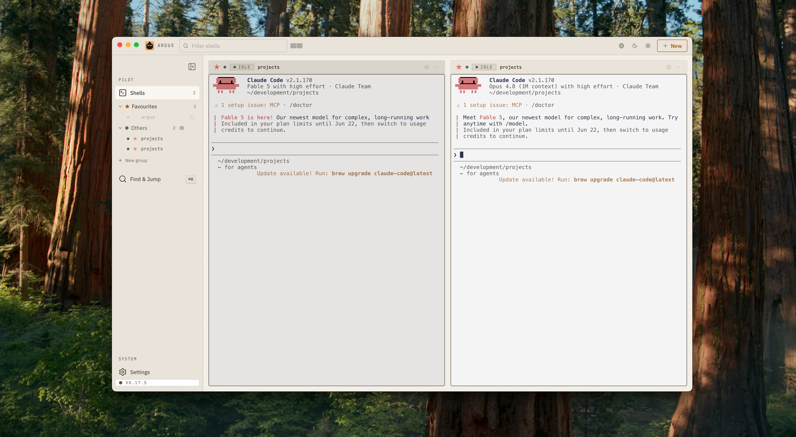

# Argus

   

A native macOS desktop app for managing multiple AI coding agent sessions at once. Spawn [Claude Code](https://claude.ai/code), [Gemini CLI](https://github.com/google-gemini/gemini-cli), or [OpenAI Codex](https://github.com/openai/codex) processes in real pseudo-terminals, watch their output side by side, and track each session's state — running, waiting, idle, or exited — in real time.



## Table of Contents

- [Installation](#installation)
  - [Installing from the DMG](#installing-from-the-dmg)
- [Features](#features)
- [Keyboard Shortcuts](#keyboard-shortcuts)
- [How It Works](#how-it-works)
- [Tech Stack](#tech-stack)
- [Project Docs](#project-docs)

## Installation

Install via [Homebrew](https://brew.sh):

```bash
brew tap antonioromano/argus https://github.com/antonioromano/argus && \
  brew trust antonioromano/argus && \
  brew install --cask argus
```

That's it — launch Argus from Spotlight or your Applications folder.

> **Why `brew trust`?** Homebrew 4.x refuses to load casks from third-party (non-official) taps until you trust them once. Without it you'll see `Refusing to load cask … from untrusted tap`. Trust is one-time per machine — after this, installs and upgrades just work.

> The app is ad-hoc signed (no Apple Developer certificate). The cask automatically strips the macOS quarantine flag on install, so the app opens normally — no right-click → Open dance required.

Update to the newest release the same way you update any cask:

```bash
brew upgrade --cask argus
```

If `brew upgrade` reports `Refusing to load cask … from untrusted tap`, run `brew trust antonioromano/argus` once, then re-run the upgrade. **In-app updates** (the built-in "Update now" button) trust the tap automatically — no manual step needed.

### Installing from the DMG

Prefer the DMG from [GitHub Releases](https://github.com/antonioromano/argus/releases)? Argus is ad-hoc signed, so macOS blocks the first launch:

1. Open the DMG and drag **Argus** to **Applications**.
2. Open Argus once. macOS says *"Apple could not verify Argus is free of malware"* — click **Done**.
3. Open **System Settings → Privacy & Security**, scroll to *"Argus was blocked to protect your Mac"*, click **Open Anyway** and confirm.

Argus opens normally from then on. On macOS 15 and later, right-click → Open no longer skips this. From Terminal instead: `xattr -dr com.apple.quarantine /Applications/Argus.app`. Homebrew installs skip all of it (the cask strips the quarantine flag). Details: [First launch](https://antonioromano.github.io/argus/install/#first-launch).

## Features

Full user docs: **[antonioromano.github.io/argus](https://antonioromano.github.io/argus/)**. One page per feature:

- [Sessions](https://antonioromano.github.io/argus/features/sessions/) — create, clone, rename, restart and resume agent sessions; status in real time
- [Session identity](https://antonioromano.github.io/argus/features/session-identity/) — a colour and an emoji per session, everywhere it appears
- [Mosaic](https://antonioromano.github.io/argus/features/mosaic/) and [Focus mode](https://antonioromano.github.io/argus/features/focus/) — every session side by side, or one at full size
- [Waiting inbox](https://antonioromano.github.io/argus/features/waiting-inbox/), [Broadcast](https://antonioromano.github.io/argus/features/broadcast/) and [Notifications](https://antonioromano.github.io/argus/features/notifications/)
- [Diff viewer](https://antonioromano.github.io/argus/features/diff/), [File explorer](https://antonioromano.github.io/argus/features/explorer/) and [Git commit & staging](https://antonioromano.github.io/argus/features/git/)
- [Usage meter](https://antonioromano.github.io/argus/features/usage-meter/) — context and plan usage per Claude or Codex session
- [Status bar](https://antonioromano.github.io/argus/features/status-bar/) and [Window restore](https://antonioromano.github.io/argus/features/window-restore/)
- [Remote access](https://antonioromano.github.io/argus/features/remote/) and the [phone companion](https://antonioromano.github.io/argus/features/mobile/)
- [Launch links](https://antonioromano.github.io/argus/features/launch-links/) — `argus://` deep links that start sessions
- [Keyboard shortcuts](https://antonioromano.github.io/argus/features/keyboard-shortcuts/)
- Beta: [worktree lifecycle](https://antonioromano.github.io/argus/beta/worktree-lifecycle/), [activity timeline](https://antonioromano.github.io/argus/beta/activity-timeline/), [session templates](https://antonioromano.github.io/argus/beta/session-templates/), [handoff](https://antonioromano.github.io/argus/beta/handoff/), [session chains](https://antonioromano.github.io/argus/beta/session-chains/)

## Keyboard Shortcuts

| Key | Action |
|-----|--------|
| `Escape` | Exit diff fullscreen → close diff panel → exit explorer fullscreen → close explorer panel → exit focus mode (priority order) |
| `Ctrl/Cmd+Enter` | Submit commit message (when commit bar is focused) |
| `Cmd+Shift+J` | Open the waiting inbox (rebindable in Settings → Keyboard) |

## How It Works

1. **Session creation** — Create named sessions pointed at any local directory.
2. **PTY spawning** — Argus spawns the AI CLI inside a pseudo-terminal via your login shell (`$SHELL -l -c "exec <agent>"`).
3. **Real-time streaming** — Terminal I/O flows through Socket.io rooms. Each session is a room identified by its UUID.
4. **State detection** — Output is stripped of ANSI codes and, after a 500ms settle period, the tail is analyzed to classify the session as `waiting`, `running`, `idle`, or `exited`.
5. **Reconnect replay** — A headless xterm mirror per session (`TerminalMirror`) is serialized and replayed when a window opens or reconnects to a session.
6. **Session survival** — Agents run under `argusd`, a small bundled Go daemon that owns the ptys, so sessions survive quitting and reopening the app. A dedicated tmux server is the fallback if the daemon binary is missing.

### Testing deep links

`npm run dev` registers `argus-dev://` on the dev Electron.app (`scripts/register-dev-scheme.mjs`, also run on `npm install`). With the dev app running:

    open "argus-dev://new?agent=claude&folder=/tmp/argus-dl-test&prompt=hello"

The installed app keeps `argus://`; the two never collide. If the dev app is not running, the link opens a bare Electron window. Start `npm run dev` first.

## Tech Stack

| Layer | Technologies |
|-------|-------------|
| **Shell** | Electron (native macOS app) |
| **Server** | Express, Socket.io, node-pty, TypeScript (ESM, strict) |
| **Client** | React 19, xterm.js (DOM renderer), Socket.io-client, @dnd-kit, Vite |
| **Shared** | TypeScript strict types for session models, REST shapes, Socket.io event maps |
| **Styling** | CSS custom properties (design tokens) — no CSS framework |
| **Syntax highlighting** | Shiki (JS regex engine, lazy grammars), shared by Monaco, Chat, Markdown and diffs |
| **Icons** | lucide-react |
| **Session survival** | `argusd` pty daemon (Go, bundled); tmux fallback |

## Project Docs

- [`docs/reviews/2026-10-11-argus-review.md`](docs/reviews/2026-10-11-argus-review.md) — the current full-app review: security, bugs, performance, hygiene, feature ideas, with fix status
- [`docs/solutions/`](docs/solutions/) — write-ups of past problems and their fixes
- [`CLAUDE.md`](CLAUDE.md) — architecture notes, commands and the release recipe

---

Built for developers who run multiple AI coding agents at once.
